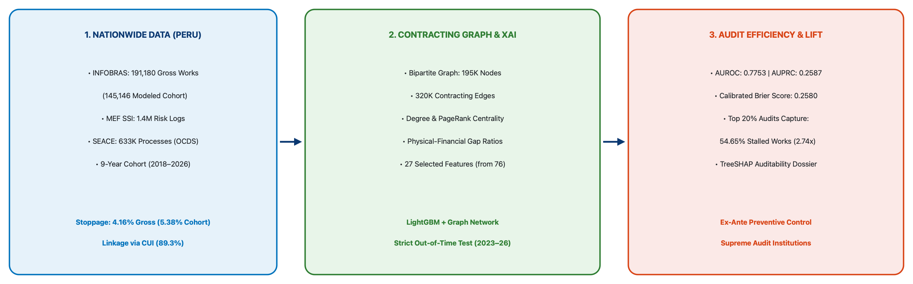
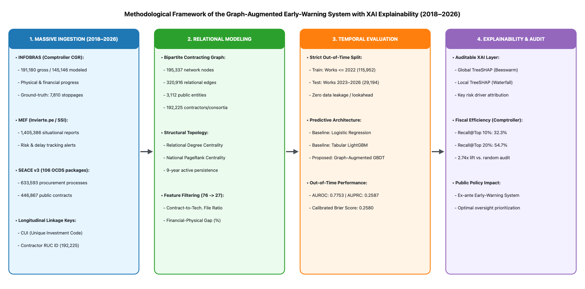

# 🏗️ Public Works Stoppage & Cost Overruns Early-Warning System (Peru)
### Graph-Augmented Machine Learning & Explainable AI (TreeSHAP) with Strict Prospective Out-of-Time Validation

[](LICENSE)
[](requirements.txt)
[](data/processed/)
[](https://revistadelaconstruccion.uc.cl/)

---

## 📌 Overview

This repository contains the complete open-source codebase, processed analytical datasets, network edge topologies, predictive models, and high-resolution visual evidence for the scientific research paper:

> **"Auditable Early-Warning of Public-Works Stoppage and Cost Overruns in Peru: A Graph-Augmented Machine Learning Framework with TreeSHAP and Strict Out-of-Time Validation"**  
> **Author:** Dr. Juan Marcos Vilchez Canchari, PhD (Escuela de Posgrado, Universidad César Vallejo, Lima, Peru)  
> **Submitted to:** *Revista de la Construcción. Journal of Construction* (Pontificia Universidad Católica de Chile, WoS / Scopus Q1-Q2)



---

## 🔬 Core Empirical Contributions

1. **Nationwide Multi-Source Integration (2018–2026):**
   - **INFOBRAS (Comptroller General CGR):** 191,180 gross recorded public works (4.16% gross stoppage rate; final analytical modeled cohort of $N = 145,146$ works after excluding incomplete or uninitiated preparatory projects).
   - **Invierte.pe / SSI (Ministry of Economy and Finance - MEF):** 1,405,386 longitudinal situational progress reports and risk alerts deterministically linked by Unique Investment Code (CUI, 89.34% coverage).
   - **SEACE v3 (OECE / OSCE Open Contracting):** 106 monthly OCDS packages parsed between 2018 and 2026, encompassing 633,593 procurement processes, 523,735 supplier awards, and 446,867 executed contracts.

2. **Bipartite Contracting Graph Modeling:**
   - Public Buying Entity–Contractor bipartite network with **195,337 nodes** (3,112 procuring entities; 192,225 private suppliers/consortia) and **320,916 relational contracting edges**.
   - Topological properties extracted: Structural PageRank, relational degree centrality, and multi-year jurisdictional market dispersion.

3. **Strict Prospective Out-of-Time Evaluation:**
   - **Training Cohort:** Works initiated on or before 2022 ($N = 115,952$, 4.34% stoppage rate).
   - **Prospective Test Cohort:** Works initiated between 2023 and 2026 ($N = 29,194$, 9.53% stoppage rate; zero lookahead bias).
   - **Results:**
     - **AUROC:** `0.7753`
     - **AUPRC:** `0.2587`
     - **Brier Score:** `0.2580` (calibrated)
     - **Recall@Top 10%:** `32.27%` of all nationwide stoppages captured.
     - **Recall@Top 20%:** `54.65%` of all nationwide stoppages captured (**2.74x efficiency lift** over random audit inspections).

4. **Auditable Explainability with TreeSHAP:**
   - Resolves black-box opacity by decomposing model decisions into line-item evidentiary dossiers that identify certified physical schedule delays, premature financial disbursements outrunning physical progress, and tender bidding discrepancies before site abandonment occurs.



---

## 📂 Repository Structure

```
.
├── figures/                                    # Publication-grade figures (300 DPI, English)
│   ├── graphical_abstract_rdlc.png             # Official 15x5 cm Graphical Abstract
│   ├── fig1_methodological_framework.png       # End-to-end methodological architecture
│   ├── fig2_roc_pr_curves.png                  # Prospective ROC and Precision-Recall curves
│   ├── fig3_shap_summary_beeswarm.png          # TreeSHAP global beeswarm plot (27 features)
│   ├── fig4_shap_waterfall_auditing_case.png   # Local TreeSHAP waterfall audit case
│   └── fig5_audit_efficiency_recall_curve.png  # Fiscal audit efficiency lift curve
├── data/                                       # Optimized analytical datasets
│   ├── processed/
│   │   └── dataset_obras_analitico.parquet     # Modeled cohort (145,146 works x 27 features, 34 MB)
│   └── interim/
│       ├── infobras_mef_integrated.parquet     # Harmonized INFOBRAS + MEF dataset (27 MB)
│       ├── linkage_summary.txt                 # CUI and RUC deterministic linkage audit
│       └── network_edges/
│           └── seace_contracting_edges.parquet # 320,916 bipartite contracting edges (25 MB)
├── reports/                                    # Validation metrics & predictions
│   ├── model_comparison_metrics.csv            # Logistic Regression vs. LightGBM vs. Graph Model
│   ├── seace_graph_topology_and_performance_summary.json # Comprehensive network audit statistics
│   └── test_predictions_graph_model.parquet    # Test set probability predictions (2023-2026)
├── paper/                                      # LaTeX manuscript source
│   ├── main_rdlc.tex                           # RDLC article source code
│   └── references.bib                          # 33 APA 6th Edition references
├── src/                                        # Reproducible Python source code
│   ├── etl/                                    # Data ingestion & network construction
│   ├── features/                               # Feature engineering & ratio extraction
│   ├── models/                                 # Chronological backtesting & training
│   └── xai/                                    # TreeSHAP explainability scripts
├── LICENSE                                     # MIT License
├── README.md                                   # Documentation and usage guide
└── requirements.txt                            # Python dependencies
```

---

## 🚀 Quickstart & Reproduction

### 1. Environment Setup
```bash
git clone https://github.com/jvilchez-ucv/Public-Works-Stoppage-Peru.git
cd Public-Works-Stoppage-Peru
python3 -m venv venv
source venv/bin/activate
pip install -r requirements.txt
```

### 2. Model Training & Evaluation
```bash
python3 src/models/04_train_models.py
```

### 3. TreeSHAP Explainability & Visualizations
```bash
python3 src/xai/05_shap_explainability.py
```

---

## 📊 Summary of Prospective Model Performance

| Model Architecture | AUPRC | AUROC | Brier Score | Recall@Top5% | Recall@Top10% | Recall@Top20% |
| :--- | :---: | :---: | :---: | :---: | :---: | :---: |
| 1. Balanced Logistic Regression (Linear) | 0.1567 | 0.6695 | 0.3196 | 9.67% | 19.94% | 36.26% |
| 2. LightGBM (Tabular Domain Baseline) | 0.2550 | 0.7733 | 0.2652 | 16.53% | 31.62% | 54.37% |
| **3. LightGBM + Graph Network (Proposed)** | **0.2587** | **0.7753** | **0.2580** | **17.25%** | **32.27%** | **54.65%** |

---

## 📖 Citation

If you use this codebase, methodology, or dataset in your research, please cite:

```bibtex
@article{vilchez2026auditable,
  title={Auditable Early-Warning of Public-Works Stoppage and Cost Overruns in Peru: A Graph-Augmented Machine Learning Framework with TreeSHAP and Strict Out-of-Time Validation},
  author={Vilchez Canchari, Juan Marcos},
  journal={Revista de la Construcci{'o}n. Journal of Construction},
  volume={25},
  number={1},
  pages={1--19},
  year={2026},
  doi={10.7764/RDLC.25.1.00}
}
```

---

## ⚖️ License
This project is licensed under the [MIT License](LICENSE).
